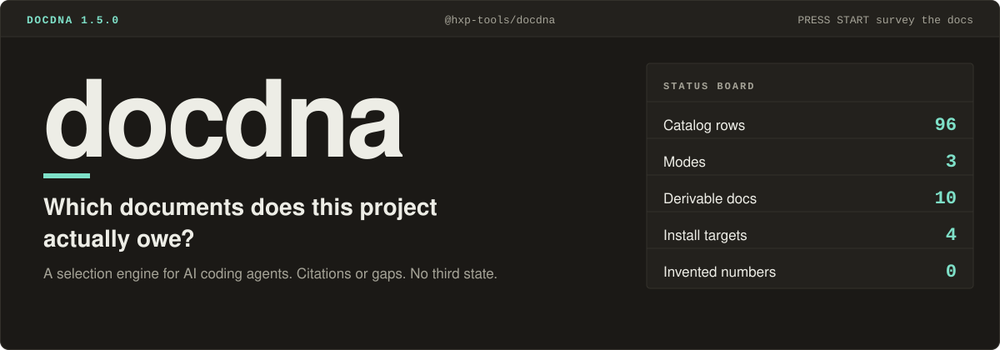
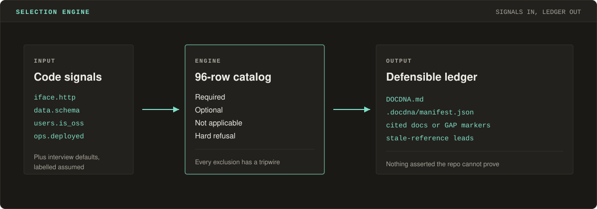

<p align="center">
  
</p>

<p align="center">
  <a href="https://github.com/hannsxpeter/docdna/actions/workflows/ci.yml"></a>
  <a href="https://www.npmjs.com/package/@hxp-tools/docdna"></a>
  <a href="CHANGELOG.md"></a>
  <a href="LICENSE"></a>
  <a href="#press-start"></a>
  <a href="#press-start"></a>
</p>

<h3 align="center">Which documents does this project actually owe?</h3>

<p align="center"><em>docdna reads your code and answers that question, with receipts.</em></p>

**docdna is a selection engine for AI coding agents.** It decides which documents a repository owes, names which it does not owe and why, arms a tripwire on every exclusion, and writes the ones the code can prove. Every claim carries a citation or a GAP marker. There is no third state.

No account, no server, no upload, no build step. Stdlib-only Python on your machine.

---

## Press start

```sh
npx @hxp-tools/docdna@latest
```

That installs the skill into your coding agent (Claude Code, Codex, Cursor, or Windsurf). Restart the agent, then ask:

> survey the documentation for this repo

Zero questions. No project docs written. No code changed. You get `.docdna/manifest.json` and a one-screen `DOCDNA.md`.

Or clone a pinned release:

```sh
git clone --branch v1.5.0 --depth 1 https://github.com/hannsxpeter/docdna.git
cd docdna
./install.sh claude      # or: all | codex | cursor | windsurf
```

New to it? [docs/QUICKSTART.md](docs/QUICKSTART.md) walks through the same run line by line.

---

## The quest map

Three levels. You can jump straight to a named document ("write the config reference"), but most people clear them in order.

<p align="center">
  
</p>

| Level | Clear it with | Reward |
| --- | --- | --- |
| 1. Survey | `survey the documentation` | `DOCDNA.md` and `.docdna/manifest.json` |
| 2. Backfill | `write the config reference` (or any derivable doc) | Cited documents, five per run |
| 3. Check | `check the docs against the code` | CI gate, tripwires, drift leads |

<p align="center">
  
</p>

---

## What a first run looks like

Zero questions, because a questionnaire is what people quit.

The block below is not an illustration. It is real output, pasted unedited, from a small example repository that ships inside this project:

```sh
cp -R tests/fixtures/internal_service /tmp/svc && python3 skill/scripts/docdna_select.py /tmp/svc
```

<!-- docdna:sample cmd="python3 skill/scripts/docdna_select.py TARGET" target="tests/fixtures/internal_service" -->
```
docdna  solo-utility  ·  335 lines Python  ·  no license  ·  CI only

Documentation  0 of 24        Leads  2 possible stale references

MISSING AND LOAD-BEARING  (22, showing 3)
  design.api-contract   Selected by iface.http. [config/urls.py]
  design.data-model     This code owns a persistent schema and the meaning of its columns lives ...
  govern.manifest       The catalog selects this document for every repository.

NOT APPLICABLE  55 documents. No compliance program exists in this repository and no external
                reviewer has been confirmed, so there is no attestation package to assemble. Full
                ledger: .docdna/manifest.json
                assure.a11y-statement is one signal away: q5_markets or q3_authorizer

NOTE            I only see documentation committed to this repo. If your docs live in Confluence or
                Notion, say so and I will mark those rows present-elsewhere rather than missing.

ASSUMED         assumed q3_authorizer=none, q2_operator=not-deployed, q5_markets=['my-org-only'].
                If a regulated relationship or external reviewer applies, up to 22 documents become
                required.

POSSIBLE STALE REFERENCES  (2)
  README.md             says `python manage.py runserver`; Procfile runs `gunicorn`; this document ...
  docs/api.md           says `11 endpoints`; 18 lines matched by the iface.http route pattern in ...
                A document may name a command without claiming this repository runs it: a comparison
                table, a task template, a case study about another repository. These are leads for a
                human to read, not findings. Full list: .docdna/manifest.json

NEXT            write 4 derivable documents  ·  refresh 1 drifted document  ·  --answer
                q3_authorizer
```

Reading it top to bottom:

- **The first line** is what docdna worked out about the project on its own.
- **Missing and load-bearing** is the short list that matters, with the file that selected each row.
- **Not applicable** is the part no other tool gives you: ruled out with a stated reason.
- **Assumed** is every guess, with the cost of being wrong attached.
- **Possible stale references** are leads, not verdicts. [docs/MEASUREMENT.md](docs/MEASUREMENT.md) publishes how often they are right.
- **Next** is two or three concrete things you could do now.

---

## Achievements

<p align="center">
  
</p>

| If you are | docdna gives you |
| --- | --- |
| **Leading a team** | A defensible answer to "what documentation do we owe?" |
| **Handing a project over** | The documents that survive the handover, written from the code |
| **Preparing for an audit** | A ledger of every document ruled in or out, with citations |
| **Writing the docs yourself** | A first draft of the mechanical documents |
| **An engineer who wants the docs done** | Ten documents generated from the code and cited, five per run |

---

## The part that earns your trust

It tells you what it did not look at.

<!-- docdna:sample cmd="python3 skill/scripts/docdna_scan.py TARGET" target="." section="not looked at, or refused" -->
```
not looked at, or refused
  a11y     : 2 signals unknown: gate did not fire
  ai       : 2 signals unknown: gate did not fire
  data     : 1 signals unknown: refuses to guess; ask q5_markets; resolved by q5_markets
  docs     : 1 signals unknown: refuses to guess; ask q8_doc_location; resolved by q8_doc_location
  jur      : 6 signals unknown: gate did not fire; resolved by q3_authorizer, q5_markets
  ops      : 4 signals unknown: refuses to guess; ask q6_downtime; resolved by q2_operator, q6_downtime
  sec      : 1 signals unknown: gate did not fire
  users    : 2 signals unknown: refuses to guess; ask q1_users; resolved by q1_users
```

Some rows say the check never ran. Others say docdna refused to guess. **A missing answer is never recorded as "no".**

---

## Trust and handoff commands in 1.5.0

Run the doctor from an installed skill before trusting a workflow. It is read-only. Exit code 0 means every check passed, 1 means a required resource or check failed, and 2 means invalid or unsafe input prevented a verdict. Recovery is to reinstall the immutable `v1.5.0` bytes and rerun the command from the installed skill directory.

```sh
python3 <skill-dir>/scripts/docdna_doctor.py --json
```

<!-- docdna:sample cmd="python3 skill/scripts/docdna_doctor.py --skill-root TARGET" target="skill" -->
```
docdna doctor: PASS
checks: 4 pass, 0 fail, 0 error
PASS runtime-registry: runtime registry schema is valid
PASS python-compatibility: Python meets the declared 3.8 minimum
PASS runtime-members: 47 registered runtime resources are present and readable
PASS proof-registry: proof registry is valid in installed-registry mode
```

Status reads at most the bounded manifest and returns exactly one next action. It never writes or executes that action.

```sh
python3 <skill-dir>/scripts/docdna_status.py --json /path/to/repo
```

<!-- docdna:sample cmd="python3 skill/scripts/docdna_status.py --json TARGET" target="tests/fixtures/internal_service" json_path="summary" -->
```json
{
  "assumptions": 0,
  "documents": 0,
  "manifest": "absent",
  "open_questions": 0,
  "tripwires": 0,
  "write_status": {
    "failed": 0,
    "in-progress": 0,
    "pending": 0,
    "verified": 0,
    "written": 0
  }
}
```

When status returns the `agent-ready` lane, run its exact Backfill argv to produce a fresh-context packet. The packet binds one document, its repository evidence, templates, proof limits, protected-prose contract, output, and verification command. Producing it writes manifest planning state, including `write_status`, but does not write the target document. Without a current manifest, Backfill first runs Survey, which also writes `.docdna/manifest.json` and `DOCDNA.md`.

```sh
python3 <skill-dir>/scripts/docdna_backfill.py --only <document-id> --json /path/to/repo
```

<!-- docdna:sample cmd="python3 skill/scripts/docdna_backfill.py --json TARGET" target="tests/fixtures/internal_service" json_path="plans.0.fresh_context_packet.execution" -->
```json
{
  "agent_spawned": false,
  "fresh_context": "recommended",
  "fresh_context_statement": "Fresh-context execution is recommended.",
  "host_execution": "unknown-until-reported",
  "host_execution_statement": "Host execution is unknown until reported.",
  "portable_fallback": "isolated sequential prompt execution, one packet at a time, with no dependence on prior conversation",
  "portable_fallback_statement": "Isolated sequential prompt execution is the portable fallback.",
  "status": "ready-for-handoff"
}
```

`docdna_proof.py` is also read-only. In a source checkout it validates evidence paths and replays the registered golden workflows. In an installed skill it validates registry schema and promotion structure only because checkout-only evidence and replay fixtures are not shipped. Neither mode proves host parity.

---

## What it will write for you

Ten documents read off the code rather than reasoned about:

- how to set up and run the project locally
- a map of the codebase
- an API reference and an API contract
- a configuration reference
- a feature flag inventory
- the data model
- a glossary of project terms
- a machine-readable index for AI assistants
- a definition of done

Anything that requires human judgment is opt-in and named explicitly. Runs are capped at five documents, estimated before they start, and resumable.

## What it refuses to write, on purpose

- **It never invents a number.** No recovery times, uptime targets, retention periods, or error budgets.
- **It never writes a legal instrument.** Seventeen of the ninety-six documents in its catalog are hard refusals enforced in code. Ask for one and it declines by name.
- **It never writes an emergency procedure.** It will write the index of which alerts have a runbook.
- **It never fakes a dependency list.** It detects your ecosystem and hands you the exact command.
- **It never touches your code.** It reports where code and documents disagree.

Full detail: [docs/COMPLIANCE.md](docs/COMPLIANCE.md).

## What is proven, and what is not

Inspect the product-claim matrix with `python3 skill/scripts/docdna_proof.py`.

- **Measured and solid.** Across 51 repositories the underlying signal layer discriminated strongly and never errored.
- **Not yet measured.** Nobody has independently judged whether the selected document set is *correct* for a given repository. Selection ships with no accuracy percentage attached.
- **Measured and modest.** Stale-reference leads are right about 3 to 11 percent of the time depending on the kind, which is why they are labelled leads.

Numbers and method: [docs/MEASUREMENT.md](docs/MEASUREMENT.md).

## Compliance, briefly

The catalog carries the SOC 2, HIPAA, PCI, GDPR, EU AI Act, CRA, and ITSG-33 rows. It does not follow that your repository owes any of them. Ninety-six entries means ninety-six rows **ruled on**, most of them not applicable with a stated reason.

| Example | Needed | Ruled out | HIPAA | PCI | SOC 2 |
| --- | --- | --- | --- | --- | --- |
| A plain internal web app | 41 | 55 | not applicable | not applicable | not applicable |
| One handling patient records | 35 | 61 | **optional**, data inventory recommended | not applicable | not applicable |
| One handling card payments | 33 | 63 | not applicable | **optional**, data flow recommended | not applicable |

Full posture in [docs/COMPLIANCE.md](docs/COMPLIANCE.md).

## Does it stand alone?

Yes. docdna needs Python 3.8 on a POSIX host. Its filesystem layer checks for descriptor-relative, no-follow primitives before using them and refuses the operation when the host cannot provide them. It needs no third-party Python package. Windows is not supported.

If you also use [codedna](https://github.com/hannsxpeter/codedna), the two run side by side: separate projects, separate installs, no shared code.

## Documentation

- [docs/QUICKSTART.md](docs/QUICKSTART.md), guided first run and glossary
- [docs/HOW-IT-DECIDES.md](docs/HOW-IT-DECIDES.md), how the document set is chosen
- [docs/MEASUREMENT.md](docs/MEASUREMENT.md), what has been measured
- [docs/COMPLIANCE.md](docs/COMPLIANCE.md), compliance posture and every refusal
- [skill/SKILL.md](skill/SKILL.md), the instructions your coding assistant follows
- [docs/AGENT_SUPPORT.md](docs/AGENT_SUPPORT.md), where it installs and what it wires
- [CONTRIBUTING.md](CONTRIBUTING.md)

## License

MIT. See [LICENSE](LICENSE).
