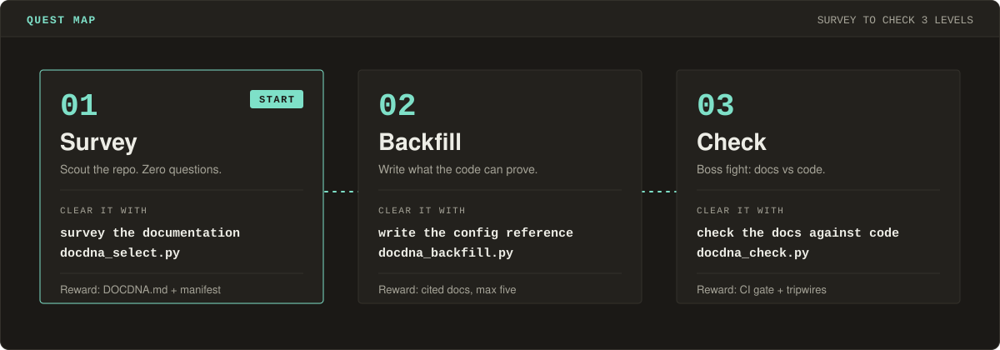
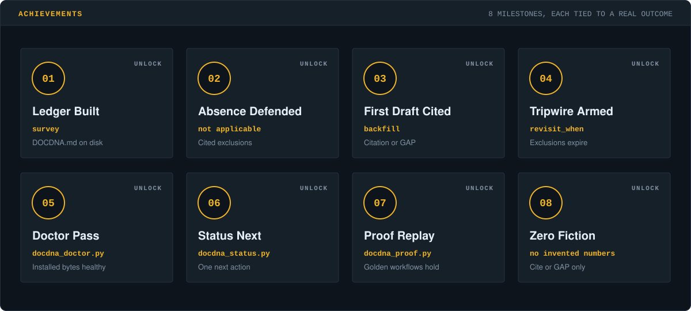

# docdna

[](https://github.com/hannsxpeter/docdna/actions/workflows/ci.yml)
[](https://github.com/hannsxpeter/docdna/releases)
[](https://www.npmjs.com/package/@hxp-tools/docdna)
[](LICENSE)


### Which documents does this project actually owe?

**docdna decides what a codebase owes, rules out the rest, and writes what the code can prove.**

It names every exclusion with a reason and a tripwire, and marks every claim with a citation or a GAP. No invented numbers. No third state. Stdlib-only Python for Claude Code, Codex, Cursor, and Windsurf.

## Quest map



| Level | Mode | Clear it with | Reward |
| --- | --- | --- | --- |
| **01** | **Survey** | "survey the documentation for this repo" | `DOCDNA.md` + manifest |
| **02** | **Backfill** | "write the config reference" | Cited docs, five per run |
| **03** | **Check** | "check the docs against the code" | CI gate + tripwires |

If no survey exists yet, Backfill and Check run one first.

## Selection engine


1. **Signals** read the code (routes, schema, deploy, license, and more).
2. **Catalog** rules each of 96 documents required, optional, not applicable, or refused.
3. **Ledger** writes `DOCDNA.md` and `.docdna/manifest.json`, then Backfill can write the derivable ten.

## Achievements



| Unlock | How you earn it |
| --- | --- |
| Ledger Built | `DOCDNA.md` exists |
| Absence Defended | Exclusions carry a cited reason |
| First Draft Cited | A backfilled doc has citations or GAPs |
| Tripwire Armed | An exclusion has `revisit_when` |
| Doctor Pass | Installed skill reports healthy |
| Status Next | One next action from the manifest |
| Proof Replay | Golden workflows hold |
| Zero Fiction | No invented numbers |

## Press start

```sh
npx @hxp-tools/docdna@latest
```

Or pick a target: `npx @hxp-tools/docdna@latest cursor` (also `claude`, `codex`, `windsurf`, or `all`).

From a pinned release:

```sh
git clone --branch v1.5.1 --depth 1 https://github.com/hannsxpeter/docdna.git
cd docdna
./install.sh cursor   # or: all | claude | codex | windsurf
```

Restart the agent, then ask:

> survey the documentation for this repo

Python 3.8+ on POSIX. Windows is not supported. Guided first run: [docs/QUICKSTART.md](docs/QUICKSTART.md). Install paths: [docs/AGENT_SUPPORT.md](docs/AGENT_SUPPORT.md).

## What a first Survey looks like

Zero questions. Real stdout from a fixture that ships in this repo:

```sh
cp -R tests/fixtures/internal_service /tmp/svc && python3 skill/scripts/docdna_select.py /tmp/svc
```

<!-- docdna:sample cmd="python3 skill/scripts/docdna_select.py TARGET" target="tests/fixtures/internal_service" -->
```
docdna  solo-utility  ·  335 lines Python  ·  no license  ·  CI only

Documentation  0 of 24        Leads  2 possible stale references

MISSING AND LOAD-BEARING  (22, showing 3)
  design.api-contract   Selected by iface.http. [config/urls.py]
  design.data-model     This code owns a persistent schema and the meaning of its columns lives ...
  govern.manifest       The catalog selects this document for every repository.

NOT APPLICABLE  55 documents. No compliance program exists in this repository and no external
                reviewer has been confirmed, so there is no attestation package to assemble. Full
                ledger: .docdna/manifest.json
                assure.a11y-statement is one signal away: q5_markets or q3_authorizer

NOTE            I only see documentation committed to this repo. If your docs live in Confluence or
                Notion, say so and I will mark those rows present-elsewhere rather than missing.

ASSUMED         assumed q3_authorizer=none, q2_operator=not-deployed, q5_markets=['my-org-only'].
                If a regulated relationship or external reviewer applies, up to 22 documents become
                required.

POSSIBLE STALE REFERENCES  (2)
  README.md             says `python manage.py runserver`; Procfile runs `gunicorn`; this document ...
  docs/api.md           says `11 endpoints`; 18 lines matched by the iface.http route pattern in ...
                A document may name a command without claiming this repository runs it: a comparison
                table, a task template, a case study about another repository. These are leads for a
                human to read, not findings. Full list: .docdna/manifest.json

NEXT            write 4 derivable documents  ·  refresh 1 drifted document  ·  --answer
                q3_authorizer
```

It also prints what it did not look at:

<!-- docdna:sample cmd="python3 skill/scripts/docdna_scan.py TARGET" target="." section="not looked at, or refused" -->
```
not looked at, or refused
  a11y     : 2 signals unknown: gate did not fire
  ai       : 2 signals unknown: gate did not fire
  data     : 1 signals unknown: refuses to guess; ask q5_markets; resolved by q5_markets
  docs     : 1 signals unknown: refuses to guess; ask q8_doc_location; resolved by q8_doc_location
  jur      : 6 signals unknown: gate did not fire; resolved by q3_authorizer, q5_markets
  ops      : 4 signals unknown: refuses to guess; ask q6_downtime; resolved by q2_operator, q6_downtime
  sec      : 1 signals unknown: gate did not fire
  users    : 2 signals unknown: refuses to guess; ask q1_users; resolved by q1_users
```

A missing answer is never recorded as "no".

## Trust commands

Before trusting an install, run the doctor. Recovery is to reinstall the immutable `v1.5.1` bytes and rerun from the installed skill directory.

```sh
python3 <skill-dir>/scripts/docdna_doctor.py --json
```

<!-- docdna:sample cmd="python3 skill/scripts/docdna_doctor.py --skill-root TARGET" target="skill" -->
```
docdna doctor: PASS
checks: 4 pass, 0 fail, 0 error
PASS runtime-registry: runtime registry schema is valid
PASS python-compatibility: Python meets the declared 3.8 minimum
PASS runtime-members: 47 registered runtime resources are present and readable
PASS proof-registry: proof registry is valid in installed-registry mode
```

Status returns exactly one next action. It never writes or executes that action.

```sh
python3 <skill-dir>/scripts/docdna_status.py --json /path/to/repo
```

<!-- docdna:sample cmd="python3 skill/scripts/docdna_status.py --json TARGET" target="tests/fixtures/internal_service" json_path="summary" -->
```json
{
  "assumptions": 0,
  "documents": 0,
  "manifest": "absent",
  "open_questions": 0,
  "tripwires": 0,
  "write_status": {
    "failed": 0,
    "in-progress": 0,
    "pending": 0,
    "verified": 0,
    "written": 0
  }
}
```

When status returns `agent-ready`, its Backfill argv produces a fresh-context packet. Producing it writes manifest planning state, including `write_status`, but does not write the target document. Without a manifest, Backfill runs Survey first.

```sh
python3 <skill-dir>/scripts/docdna_backfill.py --only <document-id> --json /path/to/repo
```

<!-- docdna:sample cmd="python3 skill/scripts/docdna_backfill.py --json TARGET" target="tests/fixtures/internal_service" json_path="plans.0.fresh_context_packet.execution" -->
```json
{
  "agent_spawned": false,
  "fresh_context": "recommended",
  "fresh_context_statement": "Fresh-context execution is recommended.",
  "host_execution": "unknown-until-reported",
  "host_execution_statement": "Host execution is unknown until reported.",
  "portable_fallback": "isolated sequential prompt execution, one packet at a time, with no dependence on prior conversation",
  "portable_fallback_statement": "Isolated sequential prompt execution is the portable fallback.",
  "status": "ready-for-handoff"
}
```

`docdna_proof.py` is read-only. Installed mode skips checkout-only evidence and replay fixtures. Neither mode proves host parity.

## What it writes, and what it refuses

Derivable from code: setup, codebase map, API reference and contract, config reference, feature flags, data model, glossary, `llms.txt`, definition of done. Cap five per run.

- Never invents a number.
- Never writes a legal instrument. Seventeen of the ninety-six catalog rows are hard refusals.
- Never writes an emergency procedure.
- Never fakes a dependency list.
- Never edits your code.

Full refusals and compliance posture: [docs/COMPLIANCE.md](docs/COMPLIANCE.md). Measurement: [docs/MEASUREMENT.md](docs/MEASUREMENT.md). How selection works: [docs/HOW-IT-DECIDES.md](docs/HOW-IT-DECIDES.md).

If you also use [codedna](https://github.com/hannsxpeter/codedna), the two run side by side.

## License

MIT. See [LICENSE](LICENSE).
